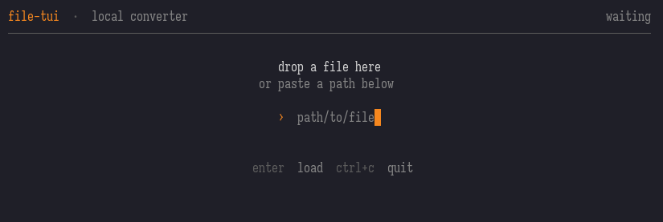
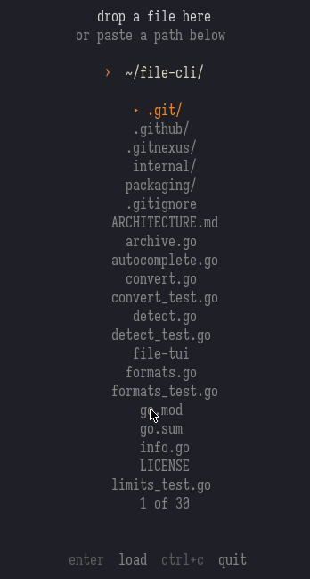
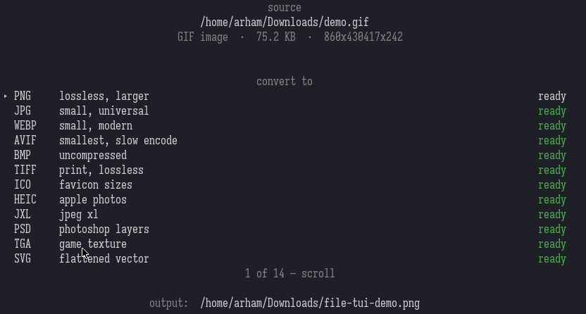

# file-tui

<p align="center">
  
</p>

<p align="center">
  <strong>A minimalist terminal UI for converting files.</strong><br>
  Detects type by magic bytes. Offers only valid targets. Never overwrites.
</p>

<p align="center">
  <a href="https://github.com/performativechud/file-tui/releases"></a>
  <a href="https://github.com/performativechud/file-tui/actions"></a>
  
  
</p>

---

## Features

- **Magic-byte detection** — identifies files by content, not extension.
- **Smart targets** — only logically valid conversions are offered.
- **No overwrites** — collisions become `-2`, `-3`, …
- **Claude Code-inspired TUI** — calm, muted palette, vertical centering.
- **Path autocomplete** — directories and files, with `~` expansion.
- **Archive safety** — byte and entry caps on extraction.
- **Cancellation** — `Esc` / `Ctrl+C` kills the whole process tree.

## Screenshots

<p align="center">
  <br>
  
  
</p>

## Install

```bash
# Go
go install github.com/performativechud/file-tui@latest

# Build from source
git clone https://github.com/performativechud/file-tui.git
cd file-tui && go build -o file-tui .
```

**Arch Linux (AUR):**
```bash
yay -S file-tui
# or
cd packaging/aur && makepkg -si
```

## Usage

```bash
file-tui                # empty UI, paste a path
file-tui <file>         # open with file loaded
file-tui -- <file>      # end-of-options marker
file-tui --version      # print version
```

### Keys

| State | Keys |
|---|---|
| empty | paste path · `enter` load · `ctrl+c` quit |
| ready | `↑↓` select · `enter` convert · `tab` locked targets · `esc` new file · `q` quit |
| running | `esc` / `ctrl+c` cancel |
| done | `o` open folder · `esc` new file · `q` quit |
| error | `r` retry · `esc` back · `q` quit |

### Output

Written beside the source as `file-tui-<name>.<ext>`. Multi-page PDF output is
`file-tui-<name>-1.png`, `-2.png`, …

## Dependencies

Detected at runtime — the more you have, the more targets unlock:

ImageMagick · ffmpeg · poppler · pandoc · LibreOffice · calibre · tesseract · 7-Zip

## Archive extraction limits

ZIP, TAR, and compressed single-file archives (gz, bz2, xz, zst) are checked
during extraction: total bytes (default 2 GiB) and entry count (default 200k).
Override with `FILE_TUI_MAX_EXTRACT_MB` and `FILE_TUI_MAX_EXTRACT_ENTRIES`
(`FILE_CLI_*` still accepted for compatibility).

7z and RAR extraction is delegated to the external 7z/unar tool. After extraction
completes, the directory is verified against the same limits. This is a
**post-extraction** check — only convert 7z/RAR archives from trusted sources.

## Limitations

- 7z/RAR relies on external tools; post-extraction verification does not prevent
  resource consumption during extraction.
- `~user` paths are not expanded (only `~` and `~/`).
- Multiline paste selects the first existing path.
- Minimum terminal width: 20 columns.
- Requires Go 1.24 to build.
- Runtime dependencies must be installed separately.

## Windows

Supported via cross-compilation. Process cancellation uses `taskkill`. Some
optional conversion utilities must be installed separately.

## Platforms

- **Linux (amd64, arm64):** Compiled and runtime-tested.
- **macOS (amd64, arm64):** Compiled. Runtime not yet verified.
- **Windows (amd64):** Supported via cross-compilation.

## License

MIT
